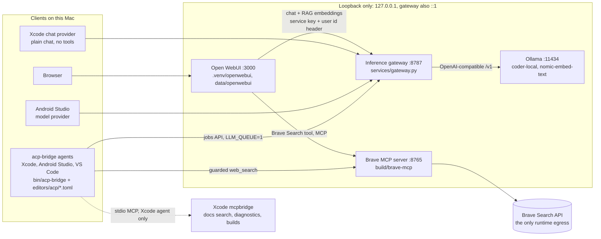
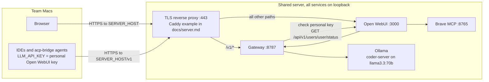
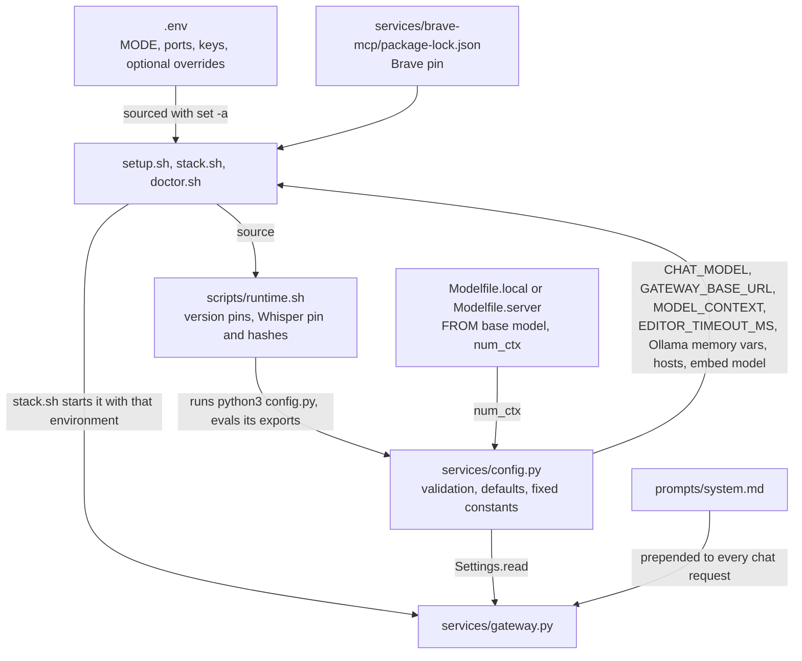
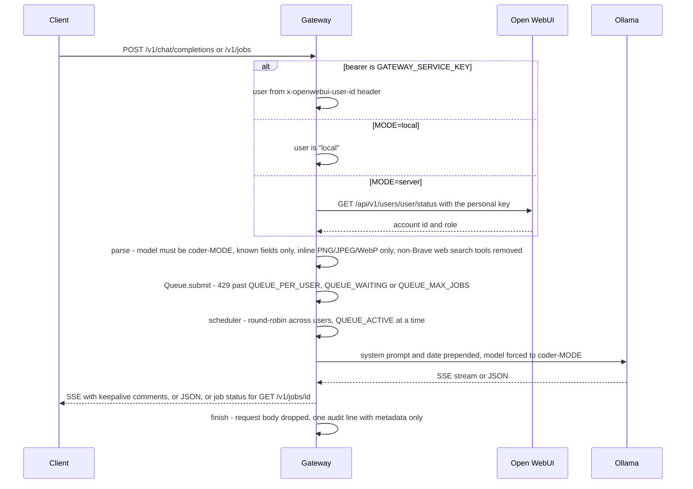

# Architecture

How the pieces of this repo connect: what runs, who starts it, how configuration reaches it, and where each hard rule (AGENTS.md / CLAUDE.md) is enforced. Read this before scanning the code. It is a map, not a replacement for the code: when it and the code disagree, the code wins, and this file gets fixed in the same change.

## What runs (local mode)

Every model call goes through the gateway: Open WebUI has its Ollama connection turned off (`ENABLE_OLLAMA_API=false`) and reaches the gateway as an OpenAI endpoint. Open WebUI's voice input runs faster-whisper inside its own process, reading the pinned model from `data/whisper/`.

## What runs (server mode)

Differences from local mode: `MODE=server` selects `Modelfile.server`; the gateway requires a personal Open WebUI API key (local mode accepts any caller as user `local`); `stack.sh` adds API keys, user status, audit logs, 12-hour logins, 15-character passwords and HTTPS-only cookies (overridable in `.env`, see docs/compliance.md); the gateway's audit log defaults on. The agents' `web_search` points at the Brave server on the developer's own Mac, so in server mode they normally have none. `server-test/` runs this layout in a Debian container on a Mac (Caddy on https://localhost:8443/, Ollama on the Mac through socat, `server-test/Modelfile.server` on `llama3.1:8b`).

## Components

| Component | Code / install | Started by | Listens on | State | Logs |
|---|---|---|---|---|---|
| Ollama | system app or service, not managed here | the user (app, `ollama serve`, systemd) | 127.0.0.1:11434 | `~/.ollama` | Ollama's own |
| Inference gateway | `services/gateway.py` + `services/config.py`, run by Open WebUI's venv Python (FastAPI, httpx, uvicorn come from there) | `stack.sh` `start_inference` | 127.0.0.1 and ::1, `GATEWAY_PORT` (8787) | in memory only | `logs/gateway.log`, `logs/gateway-audit.log` |
| Open WebUI | `open-webui==$OPEN_WEBUI_VERSION` in `.venv/openwebui`, installed by uv without rapidocr | `stack.sh` `start_openwebui` (all its env flags are set there) | 127.0.0.1, `WEBUI_PORT` (3000) | `data/openwebui/` (webui.db, cache, audit.log) | `logs/openwebui.log` |
| Brave MCP server | `build/brave-mcp/`, `npm ci` from `services/brave-mcp/package-lock.json` | `stack.sh` `start_brave`, only with `BRAVE_API_KEY`; `env -i` with just its key, cwd `build/brave-mcp` | 127.0.0.1, `BRAVE_MCP_PORT` (8765) | none | `logs/brave-mcp.log` |
| acp-bridge | `bin/acp-bridge`, built from the pinned tag + `editors/acp/acp-bridge.patch` + `queue.patch` | the IDE, over stdio | nothing (stdio) | `data/acp-bridge/`, `-android/`, `-vscode/` (sessions, 30-day retention; `allowed-commands.json`) | stderr, kept by the IDE |
| Voice cleanup | `services/voice_cleanup.py` | stored in Open WebUI's DB by `stack.sh`; runs inside Open WebUI as an event function | n/a | n/a | `logs/openwebui.log` |

The agent in each IDE is the same binary with a different config: `editors/acp/config.toml` (Xcode), `config.android.toml`, `config.vscode.toml`. Endpoint, model and key come from env vars entered in the IDE (`LLM_BASE_URL`, `LLM_MODEL`, `LLM_MODEL_CONTEXT`, `LLM_QUEUE`, `LLM_TIMEOUT`, `LLM_API_KEY` in server mode), which `setup.sh --editors` prints; the TOML files are identical in both modes. `acp-bridge.patch` adds the build-and-fix loop, Xcode tools, the guarded Brave `web_search`, history trimming, loop guards, saved sessions, images, and asking before each `bash` command (ACP `session/request_permission`: Allow / Always allow a saved prefix / Deny); `queue.patch` adds the gateway's jobs transport (idempotency key, polling, `DELETE` to cancel). Details: docs/editors.md.

## How configuration flows

- `.env` holds only per-machine settings and secrets. Every tuning setting has its default in `services/config.py` (or `stack.sh` for `BRAVE_MCP_ENABLED_TOOLS` and the server-mode Open WebUI defaults); `.env.example` lists them commented out.
- Version pins are tracked files: `OPEN_WEBUI_VERSION`, `ACP_BRIDGE_VERSION`/`ACP_BRIDGE_COMMIT` and the Whisper revision and hashes in `scripts/runtime.sh`, Brave in its lockfile. Values the hard rules fix (`WEBUI_HOST`, `BRAVE_MCP_HOST` = 127.0.0.1, `EMBED_MODEL` = nomic-embed-text) are constants in `config.py`, which refuses any other value an old `.env` still has.
- `MODE` picks `Modelfile.$MODE`, so `coder-$MODE` and its `num_ctx` (`MODEL_CONTEXT`, also reported as `context_length` by `/v1/models` and printed as `LLM_MODEL_CONTEXT` for the IDEs). `EDITOR_TIMEOUT_MS` = queue wait + inference timeout + 60 s, used for Open WebUI's `AIOHTTP_CLIENT_TIMEOUT` and the agents' `LLM_TIMEOUT`.
- Open WebUI runs with `ENABLE_PERSISTENT_CONFIG=false`, so env vars win at every start. Two settings it keeps only in its DB (the chat model's tools: Brave on, built-in tools off; the voice cleanup function) are written by `stack.sh` `set_webui_defaults` through Open WebUI's own Python models API.
- `stack.sh up` stores a hash of `.env` in `run/stack.env.sha256` and refuses to start again while the gateway runs with a different `.env`.

## A chat request through the gateway

Endpoints: `GET /health` (no auth; backend, model, queue counts), `GET /v1/models`, `POST /v1/chat/completions`, `POST /v1/embeddings` (nomic-embed-text only; queued like chat, no system prompt), `POST|GET|DELETE /v1/jobs[/{id}]` (non-streaming chat for acp-bridge; results kept `QUEUE_RETENTION_SECONDS`). Standard requests are cancelled when the client disconnects. Nothing is written to disk except the optional audit log.

## The three scripts

**`setup.sh [--editors]`** (idempotent; numbered as in the script): checks first, before any download, that `--editors` can build acp-bridge (patches present, cargo installed) → 1 Ollama installed and reachable → 2 Ollama Cloud off (`~/.ollama/server.json`; on Linux `OLLAMA_NO_CLOUD=1`, printed with the systemd lines below) → 2b Ollama memory settings (`launchctl setenv` + `~/Library/LaunchAgents/local-ai-harness.ollama-env.plist`; prints systemd lines on Linux) → 3 base model from the Modelfile's `FROM` (allowlist checked), `ollama create coder-$MODE` when `run/model-$MODE.sha256` differs, `nomic-embed-text` → 5 Open WebUI venv (rebuilt when the pin changes; rapidocr excluded; Silero VAD deleted) → 5b Whisper download, verified against the hashes → 5c Brave `npm ci` (stamp `build/brave-mcp/.stamp`) → 6 generates `WEBUI_SECRET_KEY` and `GATEWAY_SERVICE_KEY` into `.env` → 7 owner-only `data/ run/ logs/ .env` → 8 `--editors`: prints IDE registrations, builds `bin/acp-bridge` when `bin/acp-bridge.stamp` doesn't match → 9 `build/sbom.cdx.json` (`scripts/sbom.py`, rewritten only on change).

**`stack.sh up|down|status`**: `up` = refuse if `.env` changed while running → gateway → Open WebUI → Brave → `set_webui_defaults` → save the `.env` hash. PIDs in `run/*.pid`. Never starts or stops Ollama.

**`doctor.sh`**: read-only PASS/FAIL/WARN/SKIP checks of everything above, run against the live stack (one real chat completion through the gateway). The check functions are listed at the bottom of the script in run order.

`scripts/install-homebrew.sh` is a copy of Homebrew's official installer (NOTICE), offered in the README's prerequisites; nothing else calls it.

## Hard rules: where each is enforced

| Rule | In code | Checked by `doctor.sh` |
|---|---|---|
| 1 Model allowlist | `setup.sh` refuses a Modelfile `FROM` off the list; gateway accepts only `coder-$MODE` and `nomic-embed-text`; `EMBED_MODEL` constant in `config.py`; rapidocr never installed, Silero VAD deleted; Whisper pinned by hash in `runtime.sh` | `check_allowlist` (`ALLOWLIST` array), `check_webui_ocr_models`, `check_webui_vad_model`, `check_whisper_model` |
| 2 Nothing reports out | Open WebUI privacy env flags in `stack.sh` `start_openwebui`; Ollama Cloud off (setup step 2); Brave runs from `build/` with `node`, never `npx`; gateway's httpx clients use `trust_env=False`; VS Code settings printed with telemetry and traffic logging off | `check_privacy_env`, `check_ollama`, `check_brave`, `check_mac_analytics` (advisory) |
| 3 No source code in searches | `prompts/system.md` prepended by the gateway to every chat; gateway strips non-Brave web search tools (`foreign_web_search`); acp-bridge's query guard (`src/websearch.rs` via the patch) | none (unit tests in `tests/test_gateway.py`) |
| 4 Loopback only | `config.py` `loopback_url` and `LOOPBACK`; gateway `loopback_sockets`; `stack.sh` passes `--host 127.0.0.1` to Open WebUI and Brave | `check_localhost_binding`, `check_acp_web_search_url` |
| 5 Secrets only in `.env` | keys generated into `.env` (mode 600); Brave gets only its own key; editor configs carry no keys | `check_env_not_tracked`, `check_private_files`, `check_continue_retired` |

Rules 6 to 8 are about how work is done here, not code.

## Files

| Path | Role | Used by |
|---|---|---|
| `.env` / `.env.example` | per-machine settings and secrets / template with every setting | all three scripts, then the gateway via its environment |
| `Modelfile.local`, `Modelfile.server` | `coder-$MODE`: base model and `num_ctx` | `setup.sh` (`ollama create`), `config.py` (`model_context`) |
| `prompts/system.md` | system prompt for every chat | gateway (`Queue.prompt`) |
| `services/config.py` | the one configuration boundary: validation, defaults, constants, shell exports | `runtime.sh`, gateway, tests |
| `services/gateway.py` | auth, request filtering, fair queue, jobs API, audit log | `stack.sh` (`python -m services.gateway`) |
| `services/voice_cleanup.py` | Open WebUI event function deleting voice recordings | `stack.sh` stores it in Open WebUI's DB |
| `services/brave-mcp/package*.json` | Brave MCP server pin | `setup.sh` (`npm ci`), `doctor.sh` |
| `scripts/runtime.sh` | sourced after `.env`: config.py exports, version pins, Whisper pin | all three scripts |
| `scripts/sbom.py` | CycloneDX SBOM of what is installed | `setup.sh` step 9 |
| `editors/acp/*.toml` | acp-bridge config per IDE (prompt, guards, MCP policy, Brave URL, persistence, `[permissions]`) | acp-bridge at runtime; `doctor.sh` loads each |
| `editors/acp/*.patch` | our changes to upstream acp-bridge, applied in order on the pinned tag | `setup.sh --editors` (`git apply`); no script regenerates them |
| `tests/` | gateway, config and voice cleanup unit tests; simulated inference, no models | `.venv/openwebui/bin/python -m unittest discover -s tests` |
| `server-test/` | `MODE=server` in Docker on a Mac: Dockerfile, compose, `boot.sh`, Caddyfile, 8B Modelfile | `docker compose` (docs/server.md) |
| `docs/` | `editors.md` IDE setup, `privacy.md` egress findings and verified env vars, `server.md` deployment and settings reference, `compliance.md`, `comparison.md`, this file | people and agents |

State on disk (gitignored): `.venv/openwebui`, `data/` (openwebui, whisper, acp-bridge*), `logs/`, `run/` (pids, `.env` hash, Modelfile hash), `build/` (brave-mcp, acp-bridge source and cargo output, SBOM), `bin/` (acp-bridge + stamp). Outside the repo: `~/.ollama/server.json`, the LaunchAgent plist and `launchctl` env, `~/.cargo/registry`, `~/Library/Caches/acp-bridge/DerivedData`.

## Where to make common changes

| Change | Edit | Also update |
|---|---|---|
| Upgrade Open WebUI | `OPEN_WEBUI_VERSION` in `runtime.sh` | re-verify `stack.sh` env flags and `set_webui_defaults` against the new version (rule 7); record it in docs/privacy.md |
| Upgrade acp-bridge | `ACP_BRIDGE_VERSION` + `ACP_BRIDGE_COMMIT` in `runtime.sh` | both patches must still apply on the new tag |
| Upgrade Brave MCP server | `services/brave-mcp/package.json` and its lockfile together | `check_brave`'s `/ping` comment names the version it was read in |
| Change a chat model or context | `Modelfile.$MODE` | a new base model must be allowlisted: CLAUDE.md/AGENTS.md rule 1, `setup.sh` `case`, `doctor.sh` `ALLOWLIST` (needs approval) |
| Add a tunable setting | `Settings.read` in `config.py` (default there), `shell()` if scripts need it | commented line in `.env.example`, row in docs/server.md's configuration reference, `ConfigTests` |
| Add an Open WebUI env flag | `stack.sh` `start_openwebui` | privacy flags: `check_privacy_env` list and docs/privacy.md's table |
| Gateway behavior | `services/gateway.py` | `tests/test_gateway.py` |
| A new check | a `check_*` function in `doctor.sh` | add the call to the list at the bottom |
